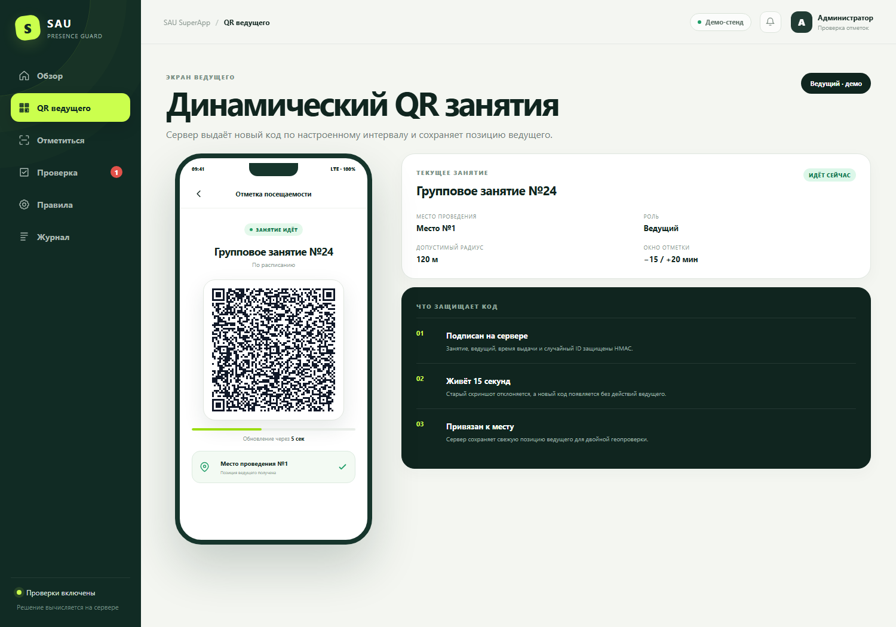
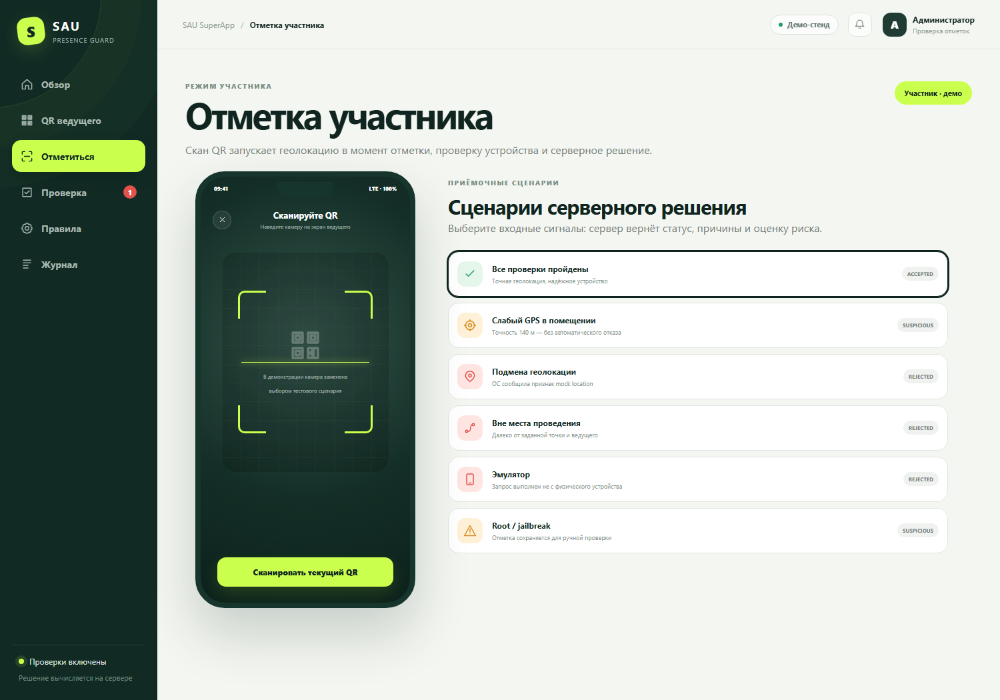

# SAU Presence Guard

Работающий MVP защищённой отметки посещаемости по ТЗ Astana Hub: динамический серверный QR, двойная геопроверка, Play Integrity / App Attest, серверный риск-анализ и ручной разбор спорных отметок.

Это новый проект, созданный после аудита предыдущей попытки. Терминология интерфейса повторяет ТЗ: ведущий, участник, занятие и место проведения. Кроссплатформенный Flutter-клиент и REST-контракт можно перенести в существующий Java backend заказчика.

## Что готово

- `backend/` — TypeScript/Fastify-модуль, SQLite для автономного демо, OpenAPI, роли и аудит;
- `backend/src/public/` — демонстрационный кабинет ведущего, участника и проверяющего;
- `mobile/` — настоящий Flutter plugin с автоматически регистрируемыми Android/iOS native bridges;
- `backend/test/` — 26 автоматических приёмочных сценариев;
- `docs/` — матрица ТЗ, архитектура, интеграция, threat model, тест-план и готовый текст заявки;
- `Dockerfile` и `compose.yaml` — воспроизводимый запуск стенда;
- `scripts/package-submission.ps1` — сборка чистого отправочного ZIP без секретов и runtime-данных.

## Быстрый запуск

Нужен Node.js 22.13+.

```powershell
Copy-Item .env.example .env
npm ci
npm run check
npm run dev
```

Откройте `http://localhost:8080`.

Публичный стенд: [https://sau-presence-guard.vercel.app](https://sau-presence-guard.vercel.app).

В кабинете можно:

1. увидеть реальный подписанный QR, который обновляется каждые 10 секунд и живёт 15 секунд;
2. прогнать честную отметку, слабый GPS, mock location, удалённую точку, эмулятор и root;
3. разобрать `suspicious` в очереди и увидеть неизменяемую историю;
4. изменить интервал QR, TTL, оба радиуса и окно отметки;
5. открыть журнал и `/openapi.json`.

## Скриншоты стенда

| Динамический QR | Серверные сценарии |
|---|---|
|  |  |

Также: [обзор](docs/screenshots/01-overview.png), [очередь ручной проверки](docs/screenshots/04-review-queue.png), [правила места](docs/screenshots/05-venue-rules.png), [журнал](docs/screenshots/06-audit.png).

Публичный Vercel-стенд запускается только в отдельном режиме `public-demo` с изолированной БД в памяти. В product-режиме demo-auth и demo-attestation технически запрещены при `NODE_ENV=production`.

## Проверка

```powershell
npm run check
npm audit --omit=dev
```

Проверено на Node.js 22: strict TypeScript, production build, 26 тестов, 0 известных production-уязвимостей npm. В тестах есть просроченный/изменённый QR, повтор, расписание, mock GPS ведущего и участника, эмулятор, root/jailbreak, слабая точность, мягкое/жёсткое превышение радиуса, удалённая геолокация, общий device разных групп, невозможный скачок, review history, role isolation и границы public-demo/product.

## Docker

Локальный демонстрационный стенд с seed-данными:

```powershell
docker compose -f compose.demo.yaml up --build
```

Production-шаблон намеренно не создаёт demo-пользователей. После подключения текущей авторизации/расписания задайте два разных случайных секрета длиной не менее 32 символов:

```powershell
$env:AUTH_SECRET = '<random-auth-secret>'
$env:QR_SIGNING_SECRET = '<different-random-qr-secret>'
docker compose up --build
```

## Как принимается решение

```text
скан → подпись/TTL QR → факт выдачи QR → расписание по server UTC
     → одноразовый integrity challenge → Play Integrity / App Attest
     → место проведения + свежая позиция ведущего + GPS accuracy
     → mock/emulator/root/jailbreak + история device/location
     → accepted | suspicious | rejected + причины + audit
```

- `accepted`/`suspicious` сохраняются с уникальностью `(session, participant)`;
- повтор возвращает ту же запись и ничего не меняет;
- плохая GPS accuracy сама по себе не отклоняет честного пользователя;
- `rejected` остаётся в журнале попыток, но не создаёт посещение;
- ручное решение не стирает исходный статус и добавляется в `review_history`.

## Flutter-интеграция

В существующий `pubspec.yaml` заказчика:

```yaml
dependencies:
  sau_presence_guard:
    path: ../sau-presence-guard/mobile
```

Plugin сам регистрирует `SauPresenceGuardPlugin` на Android/iOS. Не нужно менять `MainActivity` или `AppDelegate`. Подробности и release-настройки — в [docs/INTEGRATION.md](docs/INTEGRATION.md).

## Production-границы

ТЗ требует встроить код в существующие backend и Flutter-приложение, но их репозиторий и signing credentials не переданы. Поэтому автономный стенд использует заменяемые demo-auth/SQLite, а production-интеграция подключает текущие аккаунты, Java persistence, расписание и БД заказчика. Реальные Play Integrity/App Attest verdict проверяются только с package/bundle ID, release signing и credentials заказчика; production fail-closed уже реализован.

Точные координаты являются персональными данными. Решение запрашивает их только в момент отметки, не использует background tracking и не отправляет их картографическому сервису. Политика согласия, retention, размещение БД в РК и доступы утверждаются владельцем системы до запуска — см. [docs/SECURITY_AND_PRIVACY.md](docs/SECURITY_AND_PRIVACY.md).

## Отправка

1. Заполнить три поля в [docs/SUBMISSION_RU.md](docs/SUBMISSION_RU.md): автор, контакты, URL репозитория/демо.
2. Выполнить `npm run check`.
3. Запустить `powershell -ExecutionPolicy Bypass -File scripts/package-submission.ps1`.
4. Приложить полученный `submission/sau-presence-guard-submission.zip` к решению Astana Hub.

Полное соответствие каждому пункту официального PDF — в [docs/TZ_COMPLIANCE.md](docs/TZ_COMPLIANCE.md).
